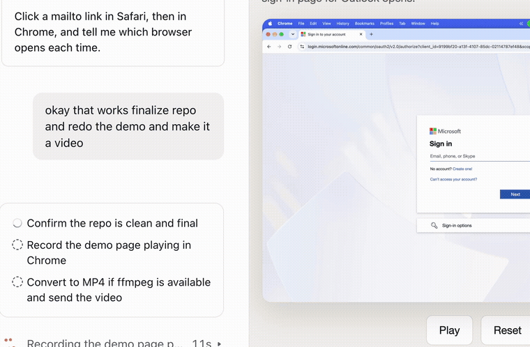

# Outlook Mail Router



A small macOS app that opens `mailto:` links in Outlook web instead of Apple Mail.

By default it picks the service from the address: Gmail addresses (`@gmail.com`, `@googlemail.com`) open a Gmail compose window, and everything else opens the Outlook inbox. To always use one service, set `provider` in `router.applescript` to `"gmail"` or `"outlook"`. It uses the browser that was in front when you clicked the link. It finds that browser with `lsappinfo`, so it needs no extra macOS permissions. If no supported browser is found, it uses `browserApp`, which is Safari by default. To change the fallback, set `browserApp` in `router.applescript` to one of:

- `"Safari"` (default)
- `"Google Chrome"`
- `"Firefox"`
- `"Microsoft Edge"`
- `"Brave Browser"`
- `"Arc"`

Change `outlookInboxURL` if your Outlook account is not a personal Outlook one.

## Setup

1. Compile the script into an app:
   ```bash
   mkdir -p ~/Applications
   osacompile -o "$HOME/Applications/Outlook Mail Router.app" router.applescript
   ```
2. Register `mailto` in the app's `Contents/Info.plist` (`CFBundleURLTypes` with scheme `mailto`) and set a `CFBundleIdentifier`.
3. Register it with Launch Services:
   ```bash
   /System/Library/Frameworks/CoreServices.framework/Frameworks/LaunchServices.framework/Support/lsregister -f "$HOME/Applications/Outlook Mail Router.app"
   ```
4. Make it the default: System Settings → Desktop & Dock → Default email reader.

## Demo

Full-quality video: [demo/final_mailto.mp4](demo/final_mailto.mp4)
